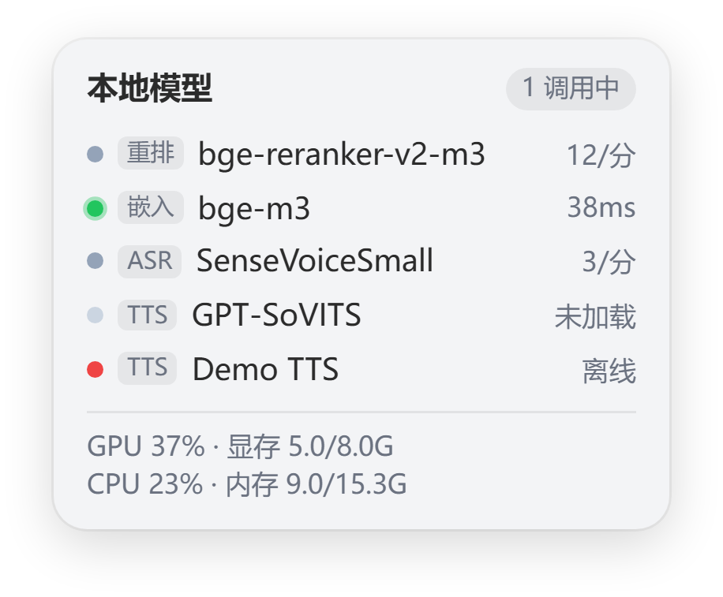

# dsh-model-lens

一个基于DSH的本地模型监管插件：监控模型服务的运行状态、请求速率和 GPU/CPU/内存的使用情况等，并提供一个手动拉起/卸载的入口。


## 安装插件

```sh
dsh plugin --profile <profile> add dsh-model-lens
```

安装完成后重启DSH生效。


## 插件功能

- 监控服务：插件扫描本机端口自动识别或手动添加模型服务；根据模型服务的状态：离线 / 空闲 / 调用中 / 加载中 等 ；拥有日志的端点还有请求速率和首字延迟；

- 管理服务：插件支持一键向已配置端点写入 start / stop 描述用以 加载 / 卸载 模型；

- 资源性能：GPU 利用率与显存占用、CPU利用率、内存占用；（*需开启HUD状态卡后显示）

- 一个基于 [dsh-pet](https://github.com/PC2005-cloud/dsh-pet) 的 HUD 卡片：为 dsh-pet 桌面宠物添加一个显示模型服务状态的可收起HUD卡片，附带一个桌宠与卡片互动的动画。

- 插件依赖：本插件可依赖 [dsh-pet](https://github.com/PC2005-cloud/dsh-pet) 提供一个可选的桌面HUD。

## 模型服务

- 插件默认只读服务状态。加载管理需要在「设置 → 本地模型监控 → 监控配置 → 加载启动命令」开启，服务开启后会向配置的端点注入start / stop 描述用以管理模型服务；日志： `~/.dsh/dsh-model-lens-logs/<id>.log`

- HUD卡片上的加载按钮可在「设置 → 本地模型监控 → 监控配置 → 卡片按钮」 开启 / 关闭。

- **插件默认不卸载外部拉起的服务进程，可在「设置 → 本地模型监控 → 监控配置 → 外部服务」开启。开启后可卸载非本插件拉起的模型服务，对没有配 `stop` 命令的端点，插件会找出监听该端口的本机进程并结束整棵进程树，该功能可能导致插件杀死错误的服务进程。**

- 无法自动识别的模型服务在「设置 → 本地模型监控 → 监控配置」里手填入：类型、名称、端口；非标准端口也可加进 `scanPorts`。

## 桌面HUD

- 确认安装并配置好 dsh-pet 后，在「设置 → 本地模型监控 → 界面配置」点击「运行激活补丁」：在桌宠身边添加一张HUD卡片并为桌宠加入小动作「戳戳小圆球」。

- 补丁更改 dsh-pet ——`node_modules/dsh-pet` 的 host/helper 文件、配置和动作视频。备份目录： `~/.dsh/dsh-model-lens-backups/`

- 「运行卸载补丁」可卸载HUD卡片与动画，卸载卡片和动画不会影响插件本体与 [dsh-pet](https://github.com/PC2005-cloud/dsh-pet) 使用。

- HUD状态卡下方「圆形」按钮，点击即可 收缩 / 展开 HUD状态卡；桌宠随机抽到「戳戳小圆球」且卡片处于收起状态时会展开收起一次卡片；`~/dsh-pet/assets/config.jsonc` 内删除「戳戳小圆球」以禁用抽卡。

- dsh-pet 更新可能会覆盖补丁，完成 dsh-pet 更新后若HUD状态卡消失则再次运行安装补丁即可。



## 兼容环境

- Node.js 22 及以上。
- Windows / Linux / macOS 。
- 本机性能若无信息可能抓取失败，核显与多卡机器上的信息可能有偏差。

## 许可

- 代码 MIT

- `pet/reactions/cutscene.webm`（「戳戳小圆球」动作）非 MIT 素材：形象是「溟月」的 DeepSeek 版女仆鲸鱼娘，按 [CC BY-NC-SA 4.0](https://creativecommons.org/licenses/by-nc-sa/4.0/deed.zh-hans)（署名 · 非商业 · 相同方式共享）使用，不可商用。

- 插件二创约定：[dsh-pet](https://github.com/PC2005-cloud/dsh-pet) 原作者：PC2005-cloud，原作者GitHub地址：https://github.com/PC2005-cloud/dsh-pet

- 动画形象出处：宠物形象为社区二创的 DeepSeek「大肥鱼」（鲸鱼娘），非 DeepSeek 官方形象；原型「溟月」出自 B 站 [@上善无形](https://space.bilibili.com/4456176)，DeepSeek 版设计出自 B 站 [@ZipZipPipe](https://space.bilibili.com/4168597)，授权声明见[原文](https://www.bilibili.com/opus/1247156596114456581)。

- 动画形象授权： [CC BY-NC-SA 4.0](https://creativecommons.org/licenses/by-nc-sa/4.0/deed.zh-hans)（署名 · 非商业 · 相同方式共享）， [声明原文](https://www.bilibili.com/opus/1247156596114456581)：「大肥鱼是遵守CC BY-NC-SA 4.0协议的形象，不可以以任何形式商业化。若您非常喜爱该形象，希望其拥有实体，您可以自行定制。」